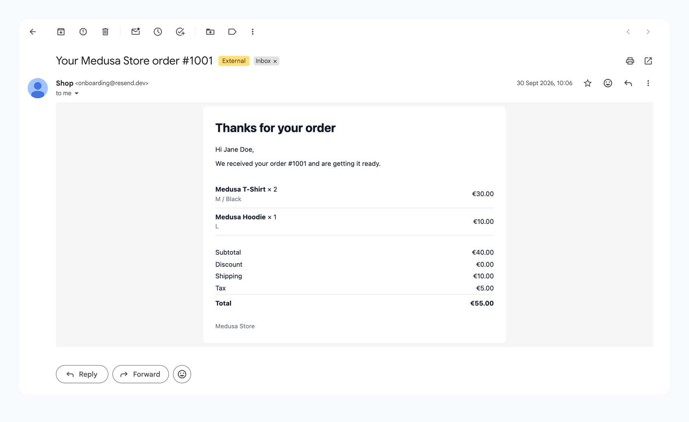
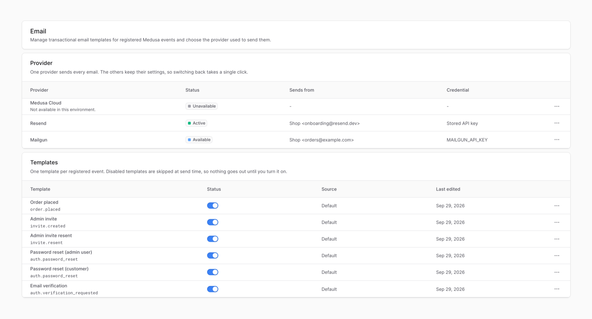
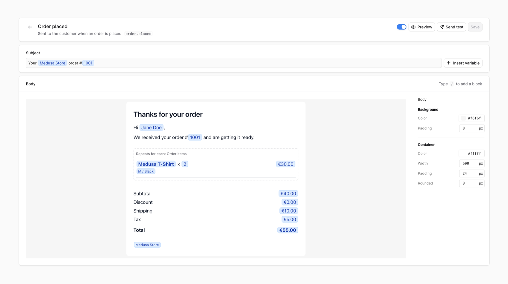
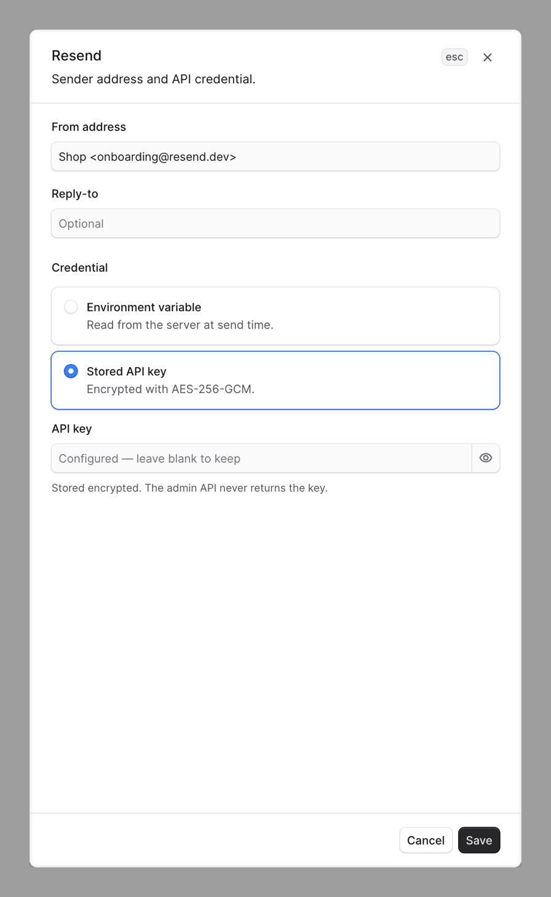

# Medusa Email Templates Plugin

[](https://www.npmjs.com/package/@agilo/medusa-email-templates-plugin)
[](https://github.com/Agilo/medusa-email-templates-plugin/blob/master/LICENSE)
[](https://nodejs.org/)

Edit transactional emails and manage delivery from Medusa Admin. The plugin includes a visual editor, ready-to-edit emails, three built-in delivery providers (Medusa Cloud, Resend, and Mailgun), and a local preview transport for development.



[Providers](#choose-a-provider) · [Template editor](#visual-editing) · [Built-in emails](#built-in-emails) · [Install](#install) · [Credentials](#security-and-credentials) · [Plugin options](#plugin-options) · [Custom extensions](#custom-extensions)

## Choose a provider

Medusa Cloud, Resend, and Mailgun are included as delivery providers. One provider sends each email; the others keep their settings. In development, you can select Local Preview to write the rendered email to a local file instead.

| Provider     | Setup in Admin                                                                                                      | Availability                                                                                                             |
| ------------ | ------------------------------------------------------------------------------------------------------------------- | ------------------------------------------------------------------------------------------------------------------------ |
| Medusa Cloud | Choose **Use**. Credentials are managed by your Medusa Cloud project.                                               | Requires an application running on Medusa Cloud with its email configuration injected. Unavailable in local development. |
| Resend       | Enter a sender address, an optional reply-to address, and an API credential.                                        | Requires a Resend account and a key with sending access.                                                                 |
| Mailgun      | Enter a sending domain, its US or EU region, a sender address, an optional reply-to address, and an API credential. | Requires a Mailgun account. A Domain Sending Key is sufficient; the plugin only calls the send endpoint.                 |
| Local Preview | Choose **Use** in development. No credentials are needed.                        | Available only when `NODE_ENV=development`. Sends are written as local HTML preview files instead of being delivered. |

With **Local Preview** selected, the plugin logs a `file://` URL for each email in the Medusa server output. Open the URL in a browser or with your operating system's file opener. The preview file is written to the system temporary directory. The transport does not launch a browser or iOS Simulator automatically and is unavailable outside development.



To start sending:

1. Open the provider's row menu and choose **Configure**. For Resend or Mailgun, fill in the sender and credential fields, then choose **Save & activate**.
2. Use **Send test** from a delivery provider's row menu to check delivery to your own inbox. For Local Preview, **Send test** creates a preview file; its recipient is shown in the preview only.
3. To switch to an available provider later, choose **Use** from its row menu.

Medusa Cloud needs no API key entered in Admin. Because the plugin owns the email channel, its built-in Cloud integration handles delivery in place of Medusa's automatically registered Cloud provider.

Switching providers uses credentials already available to the application. Adding server environment variables still requires updating your deployment environment; the [stored API key option](#security-and-credentials) lets you manage provider keys in Admin once encryption is configured.

## Visual editing



Open a template from **Settings → Email** to edit its subject and body. The editor uses [React Email Editor](https://react.email/editor) and provides:

- Rich text and email layouts, including columns and repeating blocks for lists such as order items.
- Template variables in the subject and body, with display formatting for money and dates.
- A link picker for URL variables, including configured storefront links.
- Preview and test send with example data, including unsaved edits.

Save your changes, check a test email in your inbox, then enable the template. Test sends work while a template is disabled, so you can review it before it handles live events.

Templates use [Liquid](https://liquidjs.com) for dynamic content. The plugin validates syntax when saving and generates a plain-text body from the rendered HTML when no separate text template is set.

## Built-in emails

Each email has its own editable template and enable switch.

| Email                                     | Trigger                                                           | Template key              |
| ----------------------------------------- | ----------------------------------------------------------------- | ------------------------- |
| Order confirmation, with items and totals | `order.placed`                                                    | `order-placed`            |
| Admin invitation                          | `invite.created`                                                  | `invite-created`          |
| Resent admin invitation                   | `invite.resent`                                                   | `invite-resent`           |
| Admin password reset                      | `auth.password_reset` for an admin user                           | `password-reset-user`     |
| Customer password reset                   | `auth.password_reset` for a customer                              | `password-reset-customer` |
| Email verification code                   | `auth.verification_requested` when the entity is an email address | `email-verification`      |

The verification template handles an existing verification request event; your application still owns the flow that requests and checks verification codes.

If your application already has subscribers sending the same emails, adjust them before enabling these templates to avoid duplicate messages. Notifications that already include rendered content pass through the plugin's provider unchanged.

## Install

Install the package in your Medusa application:

```bash
npm install @agilo/medusa-email-templates-plugin@latest
```

Add the plugin and its notification provider to your existing `medusa-config.ts`:

```typescript
modules: [
  {
    resolve: '@medusajs/medusa/notification',
    options: {
      providers: [
        {
          resolve: '@agilo/medusa-email-templates-plugin/providers/email',
          id: 'email-templates',
          options: { channels: ['email'] },
        },
      ],
    },
  },
],
plugins: [
  {
    resolve: '@agilo/medusa-email-templates-plugin',
    options: {
      storefront_url: 'https://shop.example.com',
    },
  },
],
```

Keep your other modules, plugins, and notification providers. Medusa allows one notification provider per channel, so replace any existing `email` provider with this one. If your application uses Medusa's local `feed` provider, retain it in the `providers` array too. The plugin registers its own modules automatically.

Run migrations, then restart your application:

```bash
npx medusa db:migrate
```

Open **Settings → Email** in Medusa Admin to configure delivery. Templates start disabled; enable each email when it is ready to send.

## Security and credentials

Resend and Mailgun support two credential sources. Choose one in the provider configuration drawer:

| Source               | How it works                                                                                                                               |
| -------------------- | ------------------------------------------------------------------------------------------------------------------------------------------ |
| Environment variable | Enter the variable name, such as `RESEND_API_KEY`. The plugin stores that name and reads the key from the server environment when sending. |
| Stored API key       | Enter the key in Admin. The plugin encrypts it with AES-256-GCM before storing it in the database.                                         |



Stored keys require `MEDUSA_EMAIL_ENCRYPTION_KEY` on the server: 32 random bytes encoded as base64 or hex. For example, generate a base64 value with `openssl rand -base64 32`, then set it through your deployment's secret configuration. Without this encryption key, environment credentials remain available and stored API keys are disabled.

Keep the encryption key stable. If it changes, existing stored credentials become unusable and must be entered again. The Admin API returns credential status and the environment variable name where applicable; it never returns API keys or ciphertext.

Template rendering escapes values in HTML output. Liquid templates cannot read files or execute JavaScript, and parsing and rendering have resource limits.

## Plugin options

Set these options in the plugin entry in `medusa-config.ts` to match your storefront and Admin routes:

| Option                           | Purpose                                                          | Default                                      |
| -------------------------------- | ---------------------------------------------------------------- | -------------------------------------------- |
| `storefront_url`                 | Base URL for customer links, such as `https://shop.example.com`. | Unset                                        |
| `storefront_reset_password_path` | Customer password reset page.                                    | `/reset-password`                            |
| `storefront_order_path`          | Order details path; the order ID is appended.                    | `/orders`                                    |
| `admin_url`                      | Base Admin URL for invitations and admin password resets.        | The application's backend URL and Admin path |

For example, a storefront with account pages can use:

```typescript
options: {
  storefront_url: 'https://shop.example.com',
  storefront_reset_password_path: '/account/new-password',
  storefront_order_path: '/account/orders',
  admin_url: 'https://admin.example.com/app',
},
```

Without `storefront_url`, customer password reset emails are skipped. Order confirmations still send, but their order link is unavailable. Admin shows a warning when the storefront URL is missing.

## Custom extensions

Developers can add application-specific email events and delivery providers through `@agilo/medusa-email-templates-plugin/registry`.

Use `defineEmailEvent` to register an event's template, recipient, context, and editor variables. Your Medusa subscriber calls `sendEmailEventWorkflow` when the event occurs. The registered template then appears alongside the built-in emails in Admin.

Event definitions can include snippets for the editor's slash menu. Typed variables support money and date formatting, URL selection, and lists with repeating content. The registry also exports `repeat()` and `columns()` helpers for default template layouts.

Use `registerEmailTransport` with an implementation of `EmailTransport` to add another delivery provider while keeping existing templates and event definitions.

## Compatibility

- Medusa `^2.22.7`.
- Node.js `>=24.0.0`.

## License

MIT. See [LICENSE](https://github.com/Agilo/medusa-email-templates-plugin/blob/master/LICENSE).
